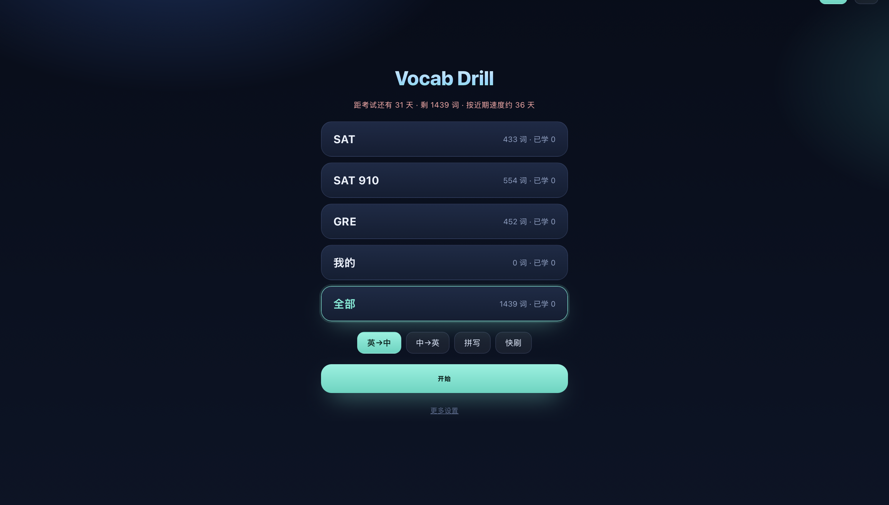

# Vocab Drill · 背单词

一个**离线可用**的 SAT / GRE 单词训练器：间隔重复、四种模式、单文件、无后端、无账号、无追踪。

[在线使用](https://yli629.github.io/vocab/) · [MIT License](LICENSE)



## 功能

- **间隔重复**：答对后 1/2/4/7/12/20 天再出现；答错当场重排，本轮再见一次
- **四种模式**：英→中、中→英、拼写（手打）、快刷（左右滑，单手可用）
- **词库**：SAT 433 · SAT 910 554 · GRE 452 · 自定义词库
- **错词本**：一键只练错过的词；连对到等级 3 自动「毕业」
- **易混词提示**：答完后并排显示 *venal / venial*、*complaisant / complacent* 这类易混对
- **速度预测**：按最近 7 天的速度，估算剩余词要几天，和考试日期对比
- **连击与完成页**：今天清完后显示张数、正确率、连击天数，可「再来 10 个」
- **离线 / 可安装**：Service Worker + manifest，添加到主屏幕后断网也能用
- **数据在本地**：进度存在 `localStorage`，可导出 JSON 换设备

## 快速开始

### 直接用

手机打开 **https://yli629.github.io/vocab/** → 分享 → **添加到主屏幕**。

### 部署自己的副本

1. 点仓库右上角 **Use this template**（或 fork）
2. 仓库里 **Settings → Pages → Deploy from a branch → `main` / `/ (root)`**
3. 打开 `https://<你的用户名>.github.io/<仓库名>/` —— 没有构建步骤，没有依赖

### 本地运行

```bash
git clone https://github.com/Yli629/vocab.git
cd vocab
python3 -m http.server 8000
# 打开 http://localhost:8000
```

> URL 加 `?fresh=1` 会以空进度打开封面页，方便截图或试玩。

## 自定义词库

设置 → **自定义词库**，每行一条：

```
ephemeral, 短暂的
ubiquitous | adj. | 无处不在的
```

点「保存并切换到我的词库」。词库存在本地，会跟着进度一起导出。

## 数据格式

所有状态是 `localStorage` 里 `vocab_srs_v4` 的一个 JSON：

```json
{
  "settings": { "newPerDay": 40, "deck": "all", "mode": "en2zh", "examDate": "2026-12-03" },
  "words": { "abate": { "lv": 2, "due": "2026-11-08", "seen": 3, "lapses": 1 } },
  "history": { "2026-11-02": { "new": 40, "seen": 62 } },
  "custom": [{ "w": "ephemeral", "p": "", "z": "短暂的" }]
}
```

## 技术

纯 HTML / CSS / JS，无构建、无依赖、无统计。词表在 `words.js`，形近词表由脚本预计算进 `confusions.js`。

## 说明

词表用于学习用途，中文释义仅供参考；引用前请以自己的教材为准。

## License

MIT — 见 [LICENSE](LICENSE)。
